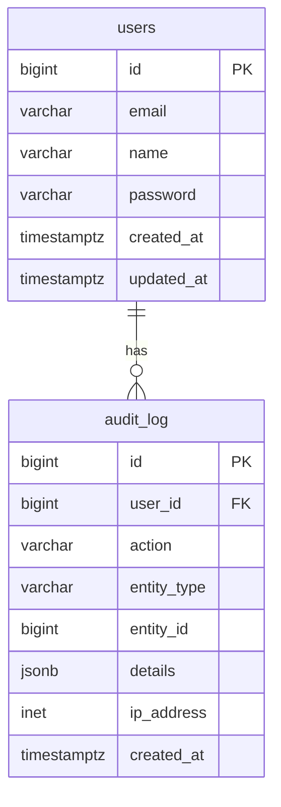
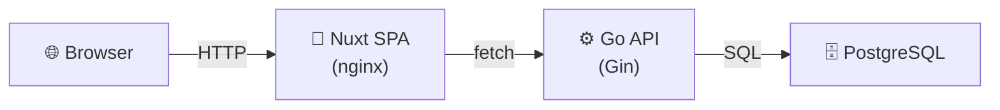

# Arkitektur

## Översikt

```
┌─────────────┐     ┌─────────────┐     ┌─────────────┐
│   Browser   │────▶│  Nuxt SPA   │────▶│   Go API    │
│             │◀────│             │◀────│             │
└─────────────┘     └─────────────┘     └──────┬──────┘
                                                │
                                                ▼
                                        ┌─────────────┐
                                        │  PostgreSQL │
                                        └─────────────┘
```

## Stack

| Lager        | Teknologi    | Docker Image        | Port | Syfte                     |
| ------------ | ------------ | ------------------- | ---- | ------------------------- |
| **Frontend** | Nuxt 3 (SPA) | `nginx:alpine`      | 80   | Interface, statiska filer |
| **API**      | Go + Gin     | `gcr.io/distroless` | 8080 | REST API, affärslogik     |
| **CLI**      | Go           | Lokal binär         | -    | Utvecklingsverktyg        |
| **Databas**  | PostgreSQL   | CNPG                | 5432 | Data-lagring (Kubernetes) |
| **Schema**   | Atlas        | Operator            | -    | Schema-migration (K8s)    |

## Kommunikation

### Arkitektur

Nuxt och Go API kommunicerar via nginx proxy för att undvika CORS och hårdkodade portar:

```
┌─────────────────────────────────────────────────────────────┐
│                     Kubernetes Cluster                       │
│                                                             │
│   ┌─────────────┐       ┌─────────────┐       ┌─────────┐  │
│   │  Nuxt SPA   │──────▶│   nginx    │──────▶│ Go API  │  │
│   │  (nginx)   │ /api/ │   proxy    │       │  :8080  │  │
│   └─────────────┘       └─────────────┘       └─────────┘  │
│         │                     │                     │       │
│         │                     │                     │       │
│         ▼                     ▼                     ▼       │
│   Browser hämta         proxy /api/           Go binary   │
│   statiska filer       till :8080             /health     │
└─────────────────────────────────────────────────────────────┘
```

### Varför nginx proxy?

| Problem                    | Lösning                             |
| -------------------------- | ----------------------------------- |
| CORS vid cross-origin      | Alla anrop är same-origin via nginx |
| Hårdkodade portar          | Relative URLs (`/api/health`)       |
| Olika portar i dev vs prod | Samma kod, nginx sköter routing     |

### Implementation

**Nuxt** - använder relativ URL:

```typescript
const response = await fetch("/api/health");
```

**nginx** - proxy config i Dockerfile:

```nginx
location /api/ {
    proxy_pass http://go-api-service:8080/;
}
```

**Resultat:**

- `localhost:9998/api/health` → nginx → `go-api-service:8080/health`
- Ingen CORS behövs
- Inga hårdkodade portar

## API Dokumentation (OpenAPI + Scalar)

Go API använder OpenAPI 2.0-specifikation med **Scalar UI** för interaktiv dokumentation:

| Endpoint                | Beskrivning              |
| ---------------------- | ------------------------ |
| `/docs/*any`           | Scalar UI (mörkt tema)   |
| `/docs/openapi.json`   | OpenAPI specifikation     |

### Implementation

Projektet använder:
- **swaggo/swag** - Genererar OpenAPI-specifikation från Go-anmärkningar
- **PeterTakahashi/gin-openapi** - Serverar Scalar UI

Konfigurationen i `main.go`:

```go
import (
    openapiui "github.com/PeterTakahashi/gin-openapi/openapiui"
)

r.GET("/docs/*any", openapiui.WrapHandler(openapiui.Config{
    SpecURL:      "/docs/openapi.json",
    Title:        "Repo Template API",
    Theme:        "dark",
}))
```

Miljövariabler:
- `DOCS_PATH` - Sökväg till swagger.json (default: `./cmd/api/docs/swagger.json`)
- `API_HOST` - Host att använda i OpenAPI-spec (sätts automatiskt i produktion)

### Lägga till dokumentation till en endpoint

Alla endpoints som ska synas i Scalar-dokumentationen måste ha swaggo-anmärkningar direkt ovanför handler-funktionen:

```go
// @Summary		Health check
// @Description	Returns the health status of the API
// @Tags			health
// @Produce		json
// @Success		200	{object}	map[string]interface{}
// @Router		/health [get]
r.GET("/health", func(c *gin.Context) {
    c.JSON(http.StatusOK, gin.H{"status": "ok"})
})
```

### Obligatoriska anmärkningar

| Anmärkning                  | Beskrivning                                 | Obligatorisk |
| --------------------------- | ------------------------------------------- | ------------ |
| `@Summary`                  | Kort beskrivning av operationen             | Ja           |
| `@Description`              | Utökad beskrivning                          | Nej          |
| `@Tags`                     | Grupp/ kategori (visas som flikar i Scalar) | Ja           |
| `@Router`                   | URL-mappning och HTTP-metod                 | Ja           |
| `@Success` eller `@Failure` | Response-specifikation                      | Ja           |

### HTTP-metod

Swaggo använder **endast `@Router`** för att ange HTTP-metod (ingen separat @Get/@Post etc). Metoden anges i hakparentes i Router-anmärkningen.

### Router-anmärkning

```go
// @Router		/endpoint [method]
```

Exempel:

```go
// @Router /users [get]
// @Router /users [post]
// @Router /users/{id} [get]
// @Router /users/{id} [put]
// @Router /users/{id} [delete]
```

### Response-specifikation

```go
// @Success		200	{object}	ModelName
// @Success		200	{array}	ModelName
// @Success		200	{object}	ResponseWrapper	"Beskrivning"
// @Failure		400	{object}	ErrorResponse
// @Failure		500	{object}	map[string]interface{}
```

Format: `{status_code}	{type}	{model_or_type}	"description"`

Typer: `object`, `array`, `string`, `integer`, `boolean`

### Path- och Query-parametrar

Format: `@Param name type dataType required "comment"`

```go
// @Param id     path     int      true  "User ID"
// @Param limit  query    int      false "Max results"        default(10)
// @Param filter query    string   false "Filter expression"
// @Param page   query    int      false "Page number"        minimum(1)
// @Param tags   query    []string false "Tags to filter by"  collectionFormat(multi)
```

**Param type** (var parametern kommer ifrån): `query`, `path`, `header`, `body`, `formData`

**Data type**: `string`, `int`, `integer`, `bool`, `boolean`, `array`, `file`

**Attributes**: `default(value)`, `minimum(n)`, `maximum(n)`, `minLength(n)`, `maxLength(n)`, `Enums(A,B,C)`, `Format(email)`

### Request body

```go
// @Accept		json
// @Param		body	body	CreateUserRequest	true	"User data"
```

### Model-definitioner

Definiera request/response-modeller som Go-structs med anmärkningar:

```go
// UserResponse är svaret för en användare
// @Description	User information with computed fields
type UserResponse struct {
    // @Description	Unik identifierare
    // @Example		123
    ID        int64  `json:"id"`

    // @Description	Användarens e-postadress
    // @Example		user@example.com
    Email     string `json:"email"`

    // @Description	Visningsnamn
    // @Example		Anna Svensson
    Name      string `json:"name"`

    // @Description	Skapad tidpunkt (ISO 8601)
    // @Example		2024-01-15T10:30:00Z
    CreatedAt string `json:"created_at"`
}

// CreateUserRequest är request-body för att skapa en användare
type CreateUserRequest struct {
    // @Description	E-postadress (unik)
    // @Example		newuser@example.com
    Email string `json:"email" binding:"required,email"`

    // @Description	Namn
    // @Example		Ny Användare
    Name  string `json:"name" binding:"required,min=2"`
}

// OBS: Swaggo läser validation-regler från Gin's `binding:"..."` taggar.
// Exempel: `binding:"required,email"`, `binding:"required,min=2,max=100"`
// Läs mer: https://pkg.go.dev/github.com/swaggo/swag#ModelDefinition

// ErrorResponse är standard-felsvar
type ErrorResponse struct {
    // @Description	Felkod
    // @Example		validation_error
    Code    string `json:"code"`

    // @Description	Felmeddelande
    // @Example		Invalid email format
    Message string `json:"message"`
}
```

### Fullständigt endpoint-exempel

```go
package handlers

import (
    "net/http"

    "github.com/gin-gonic/gin"
)

// GetUsers godoc
// @Summary		Hämta alla användare
// @Description	Returnerar en paginerad lista med alla användare i systemet
// @Tags			users
// @Accept		json
// @Produce		json
// @Param		page	query	int		false	"Sidnummer"		default(1)
// @Param		limit	query	int		false	"Resultat per sida"	default(20)
// @Param		search	query	string	false	"Sökfilter"
// @Success		200	{object}	UsersResponse
// @Failure		400	{object}	ErrorResponse
// @Failure		500	{object}	ErrorResponse
// @Router		/users [get]
func GetUsers(c *gin.Context) {
    // ... handler implementation
}

// GetUser godoc
// @Summary		Hämta en användare
// @Description	Returnerar en specifik användare baserat på ID
// @Tags			users
// @Accept		json
// @Produce		json
// @Param		id	path		int		true	"Användar-ID"
// @Success		200	{object}	UserResponse
// @Failure		404	{object}	ErrorResponse
// @Failure		500	{object}	ErrorResponse
// @Router		/users/{id} [get]
func GetUser(c *gin.Context) {
    // ... handler implementation
}

// CreateUser godoc
// @Summary		Skapa ny användare
// @Description	Skapar en ny användare med angiven e-post och namn
// @Tags			users
// @Accept		json
// @Produce		json
// @Param		body	body	CreateUserRequest	true	"Användardata"
// @Success		201	{object}	UserResponse
// @Failure		400	{object}	ErrorResponse	"Valideringsfel"
// @Failure		409	{object}	ErrorResponse	"E-post redan registrerad"
// @Failure		500	{object}	ErrorResponse
// @Router		/users [post]
func CreateUser(c *gin.Context) {
    // ... handler implementation
}

// DeleteUser godoc
// @Summary		Ta bort användare
// @Description	Tar bort en användare permanent
// @Tags			users
// @Accept		json
// @Produce		json
// @Param		id	path		int		true	"Användar-ID"
// @Success		204	"Ingen content"
// @Failure		404	{object}	ErrorResponse
// @Failure		500	{object}	ErrorResponse
// @Router		/users/{id} [delete]
func DeleteUser(c *gin.Context) {
    // ... handler implementation
}
```

### Registrera handlers i main.go

Projektet använder `SpecProvider` för att läsa OpenAPI-specifikation direkt från fil istället för att importera `docs`-paketet:

```go
package main

import (
    "encoding/json"
    "net/http"
    "os"
    "strings"
    "time"

    openapiui "github.com/PeterTakahashi/gin-openapi/openapiui"
    "github.com/gin-contrib/cors"
    "github.com/gin-gonic/gin"
)

// @title           Repo Template API
// @version         1.0
// @description     API for repo-template project
// @BasePath        /

func getDocsPath() string {
    if path := os.Getenv("DOCS_PATH"); path != "" {
        return path
    }
    return "./cmd/api/docs/swagger.json"
}

func readSwaggerSpec() ([]byte, error) {
    return os.ReadFile(getDocsPath())
}

func withHost(specJSON []byte, host string) ([]byte, error) {
    var spec map[string]interface{}
    if err := json.Unmarshal(specJSON, &spec); err != nil {
        return nil, err
    }
    if host == "" {
        delete(spec, "host")
    } else {
        spec["host"] = host
    }
    return json.Marshal(spec)
}

func main() {
    r := gin.Default()

    // CORS - endast om CORS_ORIGINS är satt
    corsOrigins := os.Getenv("CORS_ORIGINS")
    if corsOrigins != "" {
        corsConfig := cors.Config{
            AllowMethods:  []string{"GET", "POST", "PUT", "PATCH", "DELETE", "OPTIONS"},
            AllowHeaders:  []string{"Origin", "Content-Type", "Accept", "Authorization"},
            ExposeHeaders: []string{"Content-Length"},
        }
        if corsOrigins == "*" {
            corsConfig.AllowAllOrigins = true
        } else {
            corsConfig.AllowOrigins = strings.Split(corsOrigins, ",")
        }
        r.Use(cors.New(corsConfig))
    }

    // Scalar UI på /docs/*any
    r.GET("/docs/*any", openapiui.WrapHandler(openapiui.Config{
        SpecURL: "/docs/openapi.json",
        SpecProvider: func() ([]byte, error) {
            host := os.Getenv("API_HOST")
            spec, err := readSwaggerSpec()
            if err != nil {
                return nil, err
            }
            return withHost(spec, host)
        },
        Title: "Repo Template API",
        Theme: "dark",
    }))

    // Health check
    // @Summary     Health check
    // @Description Returns the health status of the API
    // @Tags        health
    // @Produce     json
    // @Success     200 {object} map[string]interface{}
    // @Router      /health [get]
    r.GET("/health", func(c *gin.Context) {
        c.JSON(http.StatusOK, gin.H{
            "status":    "ok",
            "version":   os.Getenv("APP_VERSION"),
            "timestamp": time.Now().UTC().Format(time.RFC3339),
        })
    })

    // Din API routes här:
    // r.GET("/api/users", ...)
    // r.POST("/api/users", ...)

    port := os.Getenv("PORT")
    if port == "" || !strings.HasPrefix(port, ":") {
        if port == "" {
            port = "8080"
        }
        port = ":" + port
    }
    r.Run(port)
}
```

**Miljövariabler:**
- `CORS_ORIGINS` - CORS-origins ("*" för alla, kommaseparerad för specifika)
- `DOCS_PATH` - Sökväg till swagger.json (default: `./cmd/api/docs/swagger.json`)
- `API_HOST` - Host att använda i OpenAPI-spec
- `PORT` - Port att lyssna på (default: 8080)
- `APP_VERSION` - Version att visa i /health

### Generera OpenAPI-spec

```bash
# Lokalt
cd src/go && swag init -g cmd/api/main.go -o cmd/api/docs --parseFuncBody

# I Docker (automatiskt under build)
```

### Docker

OpenAPI-spec genereras i separat Docker-stage och kopieras till `/app/docs/`.

```dockerfile
# =============================================================================
# Stage 1: Generate OpenAPI docs with swag
# =============================================================================
FROM --platform=$BUILDPLATFORM golang:1.27-alpine AS swag

RUN apk add --no-cache go git && \
    go install github.com/swaggo/swag/cmd/swag@v1.16.6 && \
    mv $(go env GOPATH)/bin/swag /usr/local/bin/

WORKDIR /build
COPY . .
RUN swag init -g cmd/api/main.go -o cmd/api/docs --parseFuncBody --quiet

# =============================================================================
# Stage 2: Builder
# =============================================================================
FROM --platform=$BUILDPLATFORM golang:1.27-alpine AS builder

ENV GOTOOLCHAIN=auto CGO_ENABLED=0

RUN apk add --no-cache git ca-certificates tzdata
WORKDIR /build

COPY go.mod go.sum ./
RUN --mount=type=cache,target=/go/pkg/mod go mod download

ARG TARGETOS
ARG TARGETARCH

COPY . .
RUN --mount=type=cache,target=/root/.cache/go-build \
    go build -ldflags="-s -w" -trimpath -o /api ./cmd/api

# =============================================================================
# Stage 3: Runtime - distroless
# =============================================================================
FROM gcr.io/distroless/static-debian12:nonroot AS runtime

COPY --from=builder /api /api
COPY --from=swag /build/cmd/api/docs /app/docs

ENV DOCS_PATH=/app/docs/swagger.json
USER nonroot

EXPOSE 8080
HEALTHCHECK --interval=30s --timeout=3s CMD wget -q --spider http://localhost:8080/health

ENTRYPOINT ["/api"]
```

## Kataloger

```
src/
├── nuxt/              # Frontend (Nuxt SPA)
│   ├── app/           # Vue-komponenter, pages, routing
│   ├── nuxt.config.ts # SPA-konfiguration
│   └── Dockerfile     # Multi-stage: dev + nginx-prod
│
└── go/                # Backend (Go API)
    ├── cmd/
    │   ├── api/       # REST API entry point
    │   │   └── docs/   # Genererad OpenAPI-spec (swag)
    │   └── cli/       # CLI + TUI (counter-demo)
    ├── internal/      # Intern logik
    │   └── counter/   # Counter domain (exempel)
    ├── go.mod         # Go dependencies
    └── Dockerfile     # Multi-stage: distroless runtime

environments/
├── base/              # Gemensamma manifests
│   ├── db/
│   │   ├── schema.sql         # Databas-schema
│   │   └── atlas-schema.yaml  # Atlas Schema CRD
│   ├── go-api-deployment.yaml
│   └── nuxt-deployment.yaml
└── [dev|pr|prod]/    # Miljö-specifika overrides
```

## Kommunikation

### Frontend → API

```typescript
// Använder runtimeConfig
const config = useRuntimeConfig();
const data = await fetch(`${config.public.apiBase}/endpoint`);
```

### API → PostgreSQL

```go
// Standard database/sql med pq-drivrutin
db, _ := sql.Open("postgres", os.Getenv("DATABASE_URL"))
```

## Miljövariabler

| Variabel               | Nuxt | Go  | Beskrivning                  |
| ---------------------- | ---- | --- | ---------------------------- |
| `DATABASE_URL`         | -    | ✅  | PostgreSQL connection string |
| `NUXT_PUBLIC_API_BASE` | ✅   | -   | URL till Go API              |
| `PORT`                 | -    | ✅  | API port (default: 8080)     |

## Kör lokalt

### Go API

```bash
# Kör direkt med go run
cd src/go && go run ./cmd/api

# Eller bygg och kör
cd src/go && go build -o api ./cmd/api && ./api
```

### Go CLI (lokalt kompilerad)

CLI-verktyg kompileras lokalt (ej i Docker):

```bash
# Kompilera CLI
cd src/go && go build -o cli ./cmd/cli

# Kör CLI
./cli tui    # Interaktiv TUI
./cli get    # Visa räknare
./cli inc    # Öka
./cli dec    # Minska
./cli reset  # Återställ
```

### Nuxt dev server

```bash
cd src/nuxt && bun run dev
```

### PostgreSQL (om lokal)

```bash
docker run -d -p 5432:5432 -e POSTGRES_PASSWORD=secret postgres:16
```

### Docker

```bash
# Bygg och kör Go API
cd src/go && docker build -t repo-api . && docker run -p 8080:8080 repo-api

# Bygg och kör Nuxt SPA
cd src/nuxt && docker build -t repo-spa . && docker run -p 3000:80 repo-spa
```

### Med docker-compose (framtida)

```yaml
services:
  api:
    build: src/go
    ports:
      - "8080:8080"
    environment:
      - DATABASE_URL=postgres://user:pass@db:5432/mydb

  spa:
    build: src/nuxt
    ports:
      - "3000:80"
    environment:
      - NUXT_PUBLIC_API_BASE=http://api:8080

  db:
    image: postgres:16
```

## Databas

### Arkitektur

```
┌─────────────────────────────────────────────────────────────┐
│                     Kubernetes Cluster                        │
│                                                             │
│   ┌─────────────┐       ┌─────────────┐                    │
│   │   CNPG      │──────▶│  PostgreSQL │                    │
│   │  Operator   │       │   Cluster   │                    │
│   └─────────────┘       └─────────────┘                    │
│         │                                                 │
│         ▼                                                 │
│   ┌─────────────┐       ┌─────────────┐                    │
│   │    Atlas    │──────▶│  Database   │                    │
│   │  Operator   │       │   Schema    │                    │
│   └─────────────┘       └─────────────┘                    │
└─────────────────────────────────────────────────────────────┘
```

### Stack

| Komponent          | Teknología | Syfte                         |
| ------------------ | ---------- | ----------------------------- |
| **CNPG**           | Operator   | PostgreSQL cluster management |
| **Atlas Operator** | Operator   | Schema migration/deklarativ   |

### Schema-hantering

Schema definieras deklarativt i:

- `environments/base/db/schema.sql` - SQL-definitionsfil
- `environments/base/db/atlas-schema.yaml` - Atlas CRD

Atlas Operator reconcilerar databasen mot det definierade schemat.

### Lägga till/en ändra schema

1. **Redigera schema.sql** i `environments/base/db/`
2. **Uppdatera atlas-schema.yaml** med nya SQL:en
3. **Applicera ändringar** - Atlas planerar och kör migreringar

### CNPG Credentials

CNPG skapar automatiskt:

- Secret: `repo-template-db-app-user` (app-användare)
- Secret: `repo-template-db-superuser` (superuser)
- Service: `repo-template-db-rw` (read-write)

### Connection String

```
postgres://app:<password>@repo-template-db-rw.default.svc.cluster.local:5432/app
```

## Mermaid ER-diagram (databas)



## Mermaid Arkitektur-diagram



## Beslut

| Beslut                    | Motivering                                                                |
| ------------------------- | ------------------------------------------------------------------------- |
| **Nuxt SPA (ej SSR)**     | SEO oviktigt, enklare arkitektur, mindre image, enklare att byta frontend |
| **Go API**                | Snabb, enkel distribution, bra för REST, all affärslogik här              |
| **CLI lokalt kompilerad** | Enklare än Docker, inget extra image, snabb iteration                     |
| **Separerade containers** | Skalas oberoende, ren separation, frontend-backend oberoende              |
| **nginx för SPA**         | Minimal image (63MB), bra för statiska filer                              |
| **distroless för Go**     | Minimal image (17MB), säkert                                              |

### Varför SPA?

- **Enklare byta frontend** - Nuxt/Vue kan bytas ut mot React/Svelte utan att ändra API
- **Backend logik i Go** - All affärslogik, databashantering och API-endpoints är i Go
- **Löst kopplade komponenter** - Frontend och backend utvecklas och deployas separat
- **Mindre Docker-image** - nginx:alpine (63MB) istället för Node-runtime (280MB)

## Utökning

### Lägga till en ny tabell (steg-för-steg)

#### 1. Lägg till databasschema

Skapa eller uppdatera tabell i `environments/base/db/schema.sql`:

```sql
CREATE TABLE IF NOT EXISTS tasks (
    id          BIGSERIAL PRIMARY KEY,
    user_id     BIGINT REFERENCES users(id) ON DELETE CASCADE,
    title       VARCHAR(255) NOT NULL,
    description TEXT,
    status      VARCHAR(50) NOT NULL DEFAULT 'pending',
    created_at  TIMESTAMPTZ NOT NULL DEFAULT NOW(),
    updated_at  TIMESTAMPTZ NOT NULL DEFAULT NOW()
);

CREATE INDEX IF NOT EXISTS idx_tasks_user_id ON tasks(user_id);
CREATE INDEX IF NOT EXISTS idx_tasks_status ON tasks(status);
```

#### 2. Uppdatera Atlas CRD

Kopiera SQL till `environments/base/db/atlas-schema.yaml` (eller låt kustomize generera automatiskt).

#### 3. Skapa model och repository

```go
// src/go/internal/tasks/model.go
package tasks

type Task struct {
    ID          int64     `json:"id"`
    UserID      int64     `json:"user_id"`
    Title       string    `json:"title"`
    Description string    `json:"description,omitempty"`
    Status      string    `json:"status"`
    CreatedAt   time.Time `json:"created_at"`
    UpdatedAt   time.Time `json:"updated_at"`
}

// src/go/internal/tasks/repository.go
package tasks

type Repository interface {
    Create(task *Task) error
    GetByID(id int64) (*Task, error)
    ListByUserID(userID int64) ([]*Task, error)
    Update(task *Task) error
    Delete(id int64) error
}
```

#### 4. Skapa handler med OpenAPI-anmärkningar

```go
// src/go/internal/tasks/handlers.go
package tasks

import (
    "net/http"
    "strconv"

    "github.com/gin-gonic/gin"
)

// ListTasks godoc
// @Summary      Lista alla uppgifter
// @Description  Returnerar alla uppgifter för en användare
// @Tags         tasks
// @Accept       json
// @Produce      json
// @Param        user_id query    int      false "Användar-ID"
// @Param        status  query    string   false "Filtrera på status"
// @Success      200     {array}  Task
// @Failure      400     {object} ErrorResponse
// @Failure      500     {object} ErrorResponse
// @Router       /tasks [get]
func ListTasks(repo Repository) gin.HandlerFunc {
    return func(c *gin.Context) {
        userIDStr := c.Query("user_id")
        if userIDStr == "" {
            c.JSON(http.StatusBadRequest, gin.H{"error": "user_id required"})
            return
        }
        userID, err := strconv.ParseInt(userIDStr, 10, 64)
        if err != nil {
            c.JSON(http.StatusBadRequest, gin.H{"error": "invalid user_id"})
            return
        }

        tasks, err := repo.ListByUserID(userID)
        if err != nil {
            c.JSON(http.StatusInternalServerError, gin.H{"error": err.Error()})
            return
        }

        c.JSON(http.StatusOK, tasks)
    }
}

// GetTask godoc
// @Summary      Hämta en uppgift
// @Description  Returnerar en specifik uppgift
// @Tags         tasks
// @Accept       json
// @Produce      json
// @Param        id     path      int  true "Uppgifts-ID"
// @Success      200    {object}  Task
// @Failure      404    {object}  ErrorResponse
// @Failure      500    {object}  ErrorResponse
// @Router       /tasks/{id} [get]
func GetTask(repo Repository) gin.HandlerFunc {
    return func(c *gin.Context) {
        id, err := strconv.ParseInt(c.Param("id"), 10, 64)
        if err != nil {
            c.JSON(http.StatusBadRequest, gin.H{"error": "invalid id"})
            return
        }

        task, err := repo.GetByID(id)
        if err != nil {
            c.JSON(http.StatusNotFound, gin.H{"error": "task not found"})
            return
        }

        c.JSON(http.StatusOK, task)
    }
}

// CreateTask godoc
// @Summary      Skapa ny uppgift
// @Description  Skapar en ny uppgift
// @Tags         tasks
// @Accept       json
// @Produce      json
// @Param        body   body      CreateTaskRequest true "Uppgiftsdata"
// @Success      201    {object}  Task
// @Failure      400    {object}  ErrorResponse
// @Failure      500    {object}  ErrorResponse
// @Router       /tasks [post]
func CreateTask(repo Repository) gin.HandlerFunc {
    return func(c *gin.Context) {
        var req CreateTaskRequest
        if err := c.ShouldBindJSON(&req); err != nil {
            c.JSON(http.StatusBadRequest, gin.H{"error": err.Error()})
            return
        }

        task := &Task{
            UserID:      req.UserID,
            Title:       req.Title,
            Description: req.Description,
            Status:      "pending",
        }

        if err := repo.Create(task); err != nil {
            c.JSON(http.StatusInternalServerError, gin.H{"error": err.Error()})
            return
        }

        c.JSON(http.StatusCreated, task)
    }
}

// Request/Response modeller
type CreateTaskRequest struct {
    UserID      int64  `json:"user_id" binding:"required"`
    Title       string `json:"title" binding:"required,min=1,max=255"`
    Description string `json:"description"`
}

type ErrorResponse struct {
    Error string `json:"error"`
}
```

#### 5. Registrera route i main.go

```go
import (
    "project/internal/tasks"
)

func main() {
    r := gin.Default()

    // ... Scalar UI setup

    // Tasks routes
    taskRepo := tasks.NewPostgresRepository(db)
    taskHandlers := tasks.NewHandlers(taskRepo)

    r.GET("/tasks", taskHandlers.ListTasks)
    r.GET("/tasks/:id", taskHandlers.GetTask)
    r.POST("/tasks", taskHandlers.CreateTask)

    r.Run(":8080")
}
```

#### 6. Generera OpenAPI-spec

```bash
cd src/go && swag init -g cmd/api/main.go -o cmd/api/docs --parseFuncBody
```

#### 7. Verifiera

1. Starta API: `cd src/go && go run ./cmd/api`
2. Öppna Scalar UI: `http://localhost:8080/docs/`
3. Verifiera att `/tasks`-endpoints syns under "tasks"-tag
4. Testa endpoints med "Try it out"-funktionen

### Schema-migrering med Atlas

Atlas Operator hanterar schema-migreringar automatiskt:

```yaml
# I environments/base/atlas-schema.yaml
spec:
  schema:
    sql: |
      CREATE TABLE new_table (...);
```

Vid apply:

1. Atlas jämför önskat schema med faktiskt
2. Genererar och kör nödvändiga ALTER-statements
3. Destructiva ändringar blockeras av policy (review: ERROR)

### Lägga till en ny sida

1. Skapa `.vue`-fil i `src/nuxt/app/pages/`
2. Lägg till i `src/nuxt/app/app.vue` navigation
3. Automatisk routing via file-based routing
